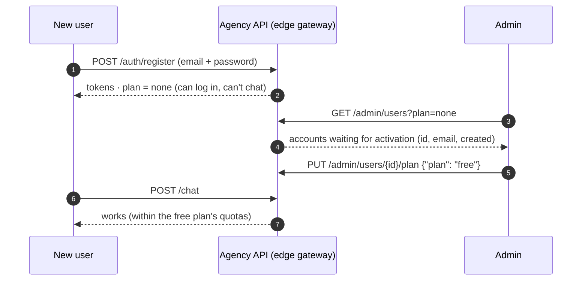
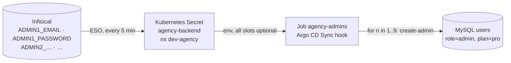

# Accounts & admins

Who can use the agency, how an account gets activated, how admins are created, and what happens with
passwords. **No email is ever sent** — the address is only the login name.

## The rule: every account must be activated

Anyone can **register** and **log in**, but a new account gets plan **`none`** (`config/plans.yaml`
`signup_plan: none`): 0 tokens, 0 requests, no topics. It can't use anything until an **admin activates** it by
giving it a real plan (`free`, `pro`, …). This protects the Gemini / Tavily keys: a stranger can create an
account, but not spend anything.



| Who | Can do |
|---|---|
| Anyone | `/docs`, `/health`, register, log in |
| Account on plan `none` | log in, `GET /auth/me`, change own password — nothing that costs |
| Activated account | chat + topics of its plan, within its quotas |
| Admin (`role=admin`, plan `pro`) | everything + `/api/v1/admin/…` (activate, reset passwords, disable, usage, quality) |

## Admins are data-driven (Infisical → Sync)

**Why:** admins are *data* (who), not *deployment structure* (what runs). Adding a person must not need a YAML
change, a code change or a new image — and their email must never land in the public gitops repo. So the list of
admins lives in **Infisical**, and one generic Job turns whatever is there into admin accounts.

**What you do:** add two secrets to Infisical (project `orchid-agency-backend-gitops`, env `dev`), then **Sync**
`dev-agency-backend` in Argo CD.

| Key | Value |
|---|---|
| `ADMIN1_EMAIL` / `ADMIN1_PASSWORD` | first admin (password ≥ 10 characters) |
| `ADMIN2_EMAIL` / `ADMIN2_PASSWORD` | second admin |
| … up to `ADMIN9_…` | gaps are fine (1, 3, 7) |

**The mechanism**, step by step:



1. **Infisical → Secret.** The External Secrets Operator copies *every* key of the Infisical project into the
   Kubernetes Secret `agency-backend` (ExternalSecret `dataFrom: find .*`). A new key needs no manifest change.
2. **Secret → Job.** The Job `agency-admins` (in `agency-backend-gitops/apps/dev/jobs.yaml`) maps
   `ADMIN1_EMAIL` … `ADMIN9_PASSWORD` into its environment with `optional: true` — a missing slot is simply an
   empty variable, the pod still starts.
3. **When.** It is an Argo CD **Sync hook** (`argocd.argoproj.io/hook: Sync`, sync-wave `-1`): it runs on **every
   Sync**, after the migrations (wave `-2`) and before the services start.
4. **What it runs.** A small loop: for each slot 1..9 with an email, `python -m edge_gateway.cli create-admin
   <email>` with that slot's password. The log ends with `admin slots checked: 1 2`.
5. **Idempotent.** An admin that already exists is skipped (`admin … already exists`) and **keeps its password** —
   so running it on every Sync is safe, and a later change of `ADMINn_PASSWORD` in Infisical does *not* change an
   existing admin's password (use the password reset below). If one creation fails, the Job fails and the Sync
   shows it.

**Remove an admin:** deleting the Infisical keys does **not** remove the account (the Job only creates).
Disable it: `POST /api/v1/admin/users/{id}/disable` (revokes its sessions too).

## Passwords

| Situation | How |
|---|---|
| I want a new password | `PUT /api/v1/auth/me/password` with the current + new password → every session is logged out |
| A user forgot theirs | an admin sets a new one: `PUT /api/v1/admin/users/{id}/password` (or CLI below) and tells the user, who then changes it |
| An admin forgot theirs | another admin resets it, or the CLI below |

Passwords are stored as bcrypt hashes (≥ 10 characters, ≤ 72 bytes) — nobody can read them back, not even in
the database.

## CLI (inside the running edge gateway)

```bash
sudo kubectl -n dev-agency exec -it deploy/edge-gateway -- python -m edge_gateway.cli <command>
```

| Command | Does |
|---|---|
| `create-admin <email>` | admin on plan `pro` (password: `ADMIN_PASSWORD` or prompt) — idempotent |
| `set-plan <email> free` | activate / change a plan |
| `set-password <email>` | new password (`NEW_PASSWORD` or prompt), logs the user out |
| `create-service-user <email>` | service account (plan `internal`), e.g. the quality worker's — idempotent |

## Rate limits see the real visitor

Register (5 per hour) and login (30 per 15 min per IP, 10 per account) are limited **per visitor IP**. Behind
Cloudflare → alb Traefik → in-cluster Traefik the app would only see a proxy address, so the edge gateway reads
the header Cloudflare sets: `CLIENT_IP_HEADER=CF-Connecting-IP`. That is safe because alb accepts port 443 from
Cloudflare's IP ranges only — nobody can reach the app without Cloudflare overwriting that header.
