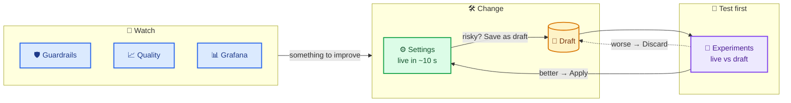
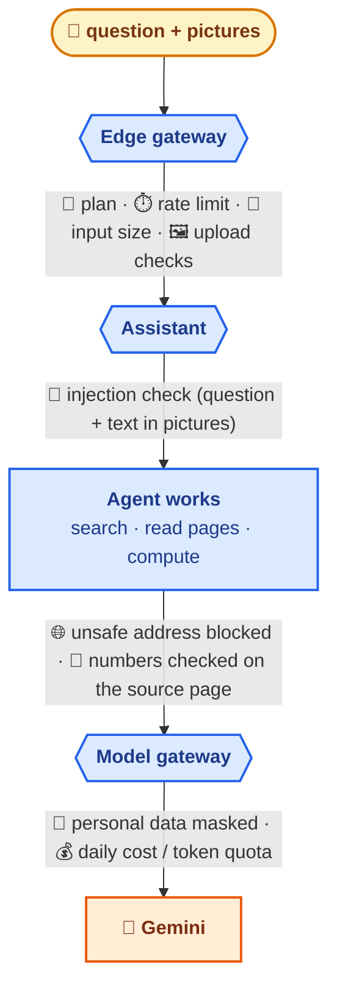
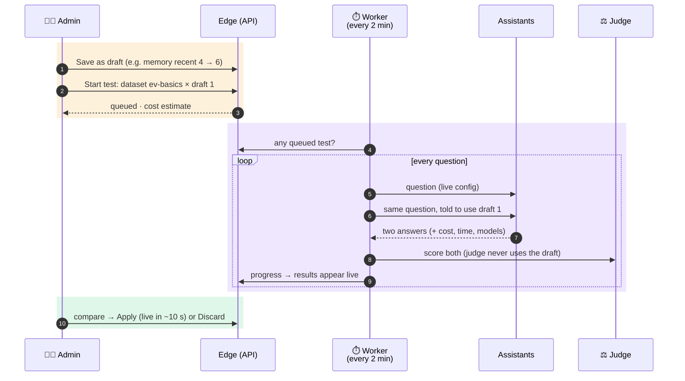
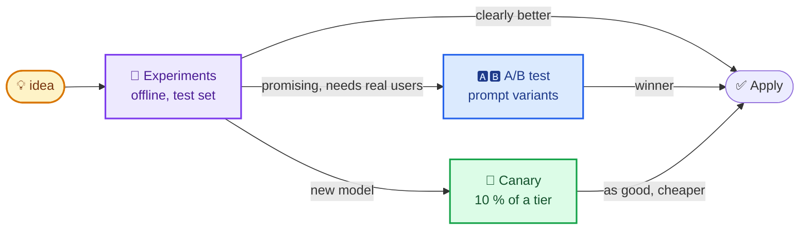

# Admin guide

Everything an admin can see and change — in the app (**Admin** in the top bar) and in Grafana. What each page is
for, when to use it, and how the pieces fit together.

!!! tip "In one sentence"
    **Watch** what happens (Guardrails, Quality, Grafana) → **change** it (Settings) → but **test risky changes
    first** (Experiments) → and only then make them live.

## The admin pages at a glance

| Page | Question it answers | You can |
|---|---|---|
| **Overview** | How much do we spend, who uses what? | read cost, questions, accounts, assistants per month |
| **Users** | Who is waiting, who is active? | activate accounts, change plans, disable, reset passwords |
| **Guardrails** | Which protections fired, for whom, why? | filter by kind and period, see the latest events |
| **Quality** | Are the answers good — and getting better or worse? | read eval / judge / drift scores, turn 👍/👎 answers into test cases |
| **Settings** | What are the limits, models, prompts right now? | change them live, save as draft, import / export, roll back |
| **Experiments** | Would this change make answers better or worse? | upload test sets, test a draft against live, compare side by side |
| **Grafana → Apps → Agency** | How does it all look over days and weeks? | graphs, and email alerts when something goes wrong |



## Guardrails — the protections, and where they fire

A guardrail is a rule that **protects users, data or money** on every question. Each time one fires it is counted
(Grafana) and logged (Admin → Guardrails) — **never with the user's text**, only what fired, where and why.



| Kind (in the log) | Protects | Fires when | Action | Tune it in |
|---|---|---|---|---|
| `scope` | the product's focus | the message is outside `config/scope.yaml` (recipes, homework, politics…) → a short polite refusal with example questions; the assistant never runs | blocked | Settings → Scope |
| `plan` | business | assistant not in the plan / account not activated | blocked | Settings → Plans & limits |
| `quota` | money | daily tokens / cost / assistant limit reached | blocked | Settings → Plans & limits |
| `rate_limit` | service | too many requests per minute | blocked | Settings → Plans & limits |
| `input_rejected` | service | empty or too long question | blocked | — |
| `injection` | the assistant's instructions | text tries to override them ("ignore previous instructions", "reveal your system prompt") — in the question **or written inside a picture** | flagged / blocked | Settings → Guardrails → `injection.mode` |
| `pii_masked` | users' privacy | emails, phones, cards, IBAN, SSN in a message to an LLM | masked | Settings → Privacy |
| `grounding` | correctness | a number the model read is **not on the source page** | dropped | — (always on) |
| `unsafe_url` | the platform | a page or picture address points to an internal / non-public host | blocked | — (always on) |
| `upload_refused` | storage, cost | picture not JPEG/PNG/WebP, too big, too many, daily cap | blocked | Settings → Guardrails → `pictures` |

**Reading the Guardrails page**

- **Per day** — coloured bars per kind: a sudden spike = something new is happening.
- **What fired** — totals in the period; click one to see only those events.
- **Latest events** — who (email), which assistant, the technical detail (e.g. `patterns: ignore_instructions
  (question, score 0.7)`, `not on www.example.com: range_km`).

??? question "Injection: flag or block?"
    **flag** (default): logged, the question still runs. The assistants already treat web pages as data and only
    have read-only tools, so an attempt rarely achieves anything — but you see who tries. **block**: refused with a
    friendly message; in a picture only that picture's text is withheld. Start with flag; switch to block if the
    log shows real attempts. The check is a tripwire (patterns in English, German, French, Spanish), not a wall —
    optional `llm_check` asks a cheap model about borderline questions.

??? question "I see many `grounding` events — is that bad?"
    No — it means the protection works: a model claimed a number the page doesn't contain, and it was thrown away
    instead of shown. Many events for one site = that site's pages are hard to read; worth a look.

## Quality — are the answers good?

Four signals, from cheapest to most realistic:

| Signal | What | Runs |
|---|---|---|
| **Offline evals** | a fixed test set per assistant, checked + scored by a judge model; a **gate** fails when quality drops vs the baseline | on demand / CI |
| **Online judge** | a **sample of real answers** scored by a strong model (1–5) | hourly |
| **Drift** | today vs the last days: judge score, 👎 rate, errors, cost, model mix — flags what moved | hourly |
| **👍 / 👎** | users' own rating under every answer | live |

A 👎 (with the user's note) lands in **Quality → Rated answers**. **Make it a test** adds it to the eval dataset —
so every bad answer becomes a test that a future change must pass.

## Settings — change it live, safely

Every value the assistants use comes from `config/*.yaml` and `prompts/*.yaml` in the image. Settings puts **changes
on top** of those files — the files stay the defaults.

| Section | Examples |
|---|---|
| Plans & limits | daily tokens / $ per plan, requests per minute, which assistants a plan has |
| Models & routing | which model serves the low / mid / high tier, which tier each task gets, canaries |
| Guardrails | injection mode, picture limits |
| Chat memory | messages read word for word, when to summarize ([Chat memory](memory.md)) |
| Privacy & retention | PII masking, how long texts / pictures / logs are kept |
| Quality checks | judge sampling, drift thresholds, eval gate |
| Prompts · *assistant* | the system prompts, temperature, max tokens, A/B experiments |

- **Save** → live in every service within ~10 s. Every save is a **version** (who, when, why) — **Use this again**
  rolls back.
- **Save as draft** → nothing changes live; test it in Experiments first.
- **Export** downloads all live values as one JSON file; **Import** turns such a file into a **draft** and shows
  exactly what would change (`recent: 4 → 6`). Edit the file in any editor, import, test, apply.
- A value that is not valid (e.g. `-5` tokens, unknown model) is refused with the exact field.

## Experiments — test a change before it goes live

**What it is:** an *offline config test*. The same questions (a **dataset**) run twice — once with the **live**
config and once with a **draft** — and both answers are checked and scored by the **same judge**. You see, per
question and in total, whether the draft is better or worse **before any user sees it**.



**Steps**

1. **Dataset** — Experiments → *Upload a dataset*: a `.jsonl` file, one question per line (format below). Same
   name again = a new version; old versions stay (old results point at them).
2. **Draft** — Settings → change something → *Save as draft* (or *Import* a config file).
3. **Test** — on the draft: *Test it* (or Experiments → *New test*). Max 50 questions; the cost estimate shows.
   It starts within ~2 minutes and fills in live. *Stop* cancels it.
4. **Decide** — the table shows pass rate, judge score, cost per question, answer time and models, with
   green ↑ / red ↓ arrows. Open any question to read both answers and the judge's note. Then *Apply* or *Discard*
   the draft (Settings → Drafts).

**Dataset format** (same as `evals/datasets/*.jsonl`):

```json
{"id": "ev-001", "topic": "ev_research", "prompt": "Battery and WLTP range of the 2024 Ioniq 5 Long Range?",
 "checks": {"must_contain_any": ["kwh"], "require_sources": true, "max_cost_usd": 0.05},
 "rubric": "States battery capacity (kWh) and range (km) from a cited source"}
```

`checks`: `must_contain`, `must_contain_any`, `must_not_contain`, `expect_refusal`, `require_sources`,
`max_latency_s`, `max_cost_usd`, `min_judge_score` (default 3.5). `rubric` / `reference` guide the judge.

**Safe by design**

- Only that test's requests use the draft — real users never do. The draft id is accepted from **admin and
  service accounts only**, and travels to the model gateway inside the signed call token.
- Real model calls cost money: max 50 questions, an estimate before you start, one test at a time.

!!! note "The worker (`agency-experiments`)"
    A Kubernetes CronJob starts a short-lived pod every 2 minutes. If no test is queued it exits in seconds; if
    one is, it runs it and saves progress after every question. *Never two at once*: if a test is still running
    at the next tick, that tick is skipped.

## Experiments vs A/B test vs canary

Three ways to compare — different moments, different audiences:

| | **Experiments** (config test) | **A/B test** (prompt experiment) | **Canary** (new model) |
|---|---|---|---|
| Who gets the answers | nobody — a fixed test set | **real users**, split (e.g. 50/50, stable per user) | **real traffic**, a small % (e.g. 10 %) |
| When | **before** going live | **while** live | while live, before promoting a model |
| Compares | anything in Settings (limits, models, prompts, memory…) | two versions of **one prompt** | a new model vs the current one in a tier |
| Measured by | checks + judge on known questions | online judge, 👍/👎, cost per variant | errors, latency, cost, judge |
| Risk for users | none | some users get the weaker variant | some answers come from the new model |
| Where | Admin → Experiments | Settings → Prompts · *assistant* → `experiments` | Settings → Models & routing → `canaries` |



Rule of thumb: **always Experiments first** (free of user risk, minutes); use an **A/B test** only when the
difference needs real users' questions to show; use a **canary** to introduce a new model gently.

## Grafana — trends and alerts

Grafana → **Apps → Agency**: questions per assistant, failures, answer time, **cost per model per day**, tokens,
cache hits, guardrails per kind, PII masked, judge / eval scores, drift, 👍/👎, HTTP errors.

Alerts (email, from Prometheus):

| Alert | When | Severity |
|---|---|---|
| AgencyManyFailedAnswers | > 30 % of questions failed in 30 min (at least 5) | page |
| AgencyInjectionSpike | > 10 injection attempts in an hour | ticket |
| AgencyLLMCostHigh | > $2 of LLM cost in 24 h | ticket |
| AgencyMetricsMissing | no agency metrics for 30 min | ticket |

## Where things are stored

| What | Where |
|---|---|
| Guardrail events | MySQL `guardrail_events` (90 days) + Prometheus counters |
| Settings versions / drafts | MySQL `settings_versions`, `settings_drafts` |
| Datasets | bucket `agency/datasets/<name>/v<n>.jsonl` + MySQL `eval_datasets` |
| Test runs and results | MySQL `config_tests` |
| Users' pictures | bucket `agency/uploads/<user>/<chat>/<time>-<id>.jpg` (deleted with the chat) |

Details: [Data (MySQL & Redis)](data.md).

## What could come next

| Idea | Why |
|---|---|
| **Promote from a test** — "Apply" button right on a test result | one click from evidence to live |
| **Scheduled benchmarks** — run the main dataset nightly against live | catches slow quality drift without anyone starting a test |
| **A/B results board** — per prompt variant: judge, 👍/👎, cost | today A/B results are only in the API / Grafana |
| **Guardrail actions** — e.g. "block this user for 1 h" from an event | act where you look |
| **Dataset from production** — turn the last 50 👎 into a dataset in one click | test exactly what users complained about |
| **Approval for risky sections** — plans / models need a second admin | four-eyes on money-relevant changes |
