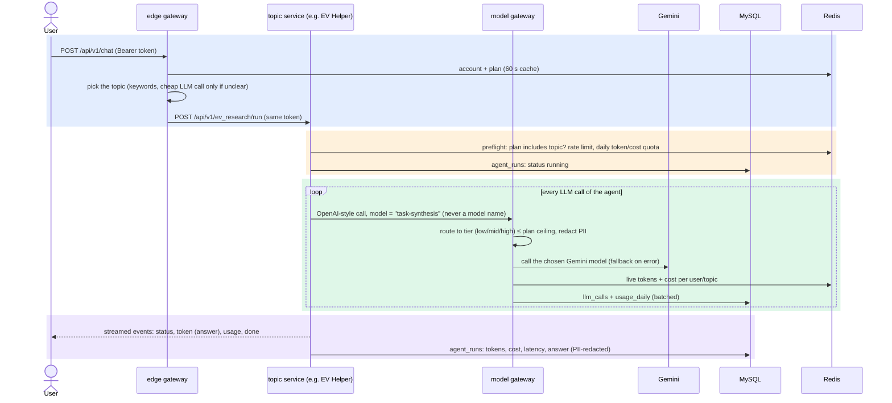

# Architecture

## Services

| Service | Role | Talks to |
|---|---|---|
| **edge gateway** | Public API: register/login (JWT), `/chat` routing, topic catalogue, usage, dashboards, admin | topics, model gateway (topic classification), MySQL, Redis |
| **EV Helper** | LangGraph state machine: parse → crawl + verify facts → calculate → write answer | model gateway, Tavily, web pages, MySQL (fact cache), Redis |
| **Product Finder** | CrewAI research agent with tools: search reviews/guides/shops → read pages (prices verified on the page by code) → search again → answer; every price in the answer checked against what the tools returned | model gateway, Tavily, shops, MySQL (offer history), Redis |
| **Finance Analyst** | AutoGen team: data analyst + strategist + compliance reviewer | model gateway, market data, Redis |
| **model gateway** | The only service with the Gemini key. Picks the model tier, falls back, caches, redacts PII, records every call | Gemini, MySQL (`llm_calls`, `usage_daily`), Redis (live quotas) |
| **quality worker** | Jobs: offline evals + gate, online LLM-judge, drift, data retention, smoke test | the APIs above, MySQL |

**Why one service per topic?** LangGraph, CrewAI and AutoGen pull in conflicting dependencies, and each
topic should be deployable and scalable on its own. Everything they have in common lives in the shared
library `libs/agency_platform`, so a new topic gets auth, quotas, tracking and streaming for free.

## What happens during one question

<small>🟦 authenticate + route · 🟨 preflight checks · 🟩 every LLM call · 🟪 answer + bookkeeping</small>

## Request authentication

- **Users** get a short-lived **access token** (JWT, 15 min) and a single-use **refresh token** from the
  edge gateway. Every service verifies the access token itself (in production with the edge's public key —
  only the edge can sign).
- **Services → model gateway** use a **call token** minted per run, signed with that service's own secret.
  It carries user, plan and request id, so every LLM call is attributed to the right user and topic.

## Data stores

| Store | Holds | Notes |
|---|---|---|
| MySQL (local 8.4 / OCI HeatWave in prod) | users, runs, LLM call ledger, usage per user × topic × day, eval results, caches of verified facts | source of truth — see [Data](data.md) |
| Redis | live quota counters, rate limits, chat memory, response + LLM caches, short-lived account cache | everything rebuildable or expiring |

## Shared library: `libs/agency_platform`

| Module | What it gives every service |
|---|---|
| `service/` | app factory: logging, request ids, security headers, error envelope, health + metrics, OpenAPI conventions |
| `auth/` | tokens, accounts, refresh-token rotation with reuse detection, `CurrentUser` / `AdminUser` dependencies |
| `agents/` | `TopicAgent` contract, `TopicRunner` (preflight, streaming, timeout, caching, accounting), topic service factory |
| `billing/` | live usage meter, quotas, rate limiter (Redis) |
| `llm/` | model gateway client, call tokens, tiers |
| `repositories/` | **all SQL** (runs, usage, LLM calls, evals, admin metrics, retention) |
| `config/` | hot-reloaded YAML parameters and prompts, validated by schemas |
| `security/` | PII redaction, SSRF-safe fetching, grounding checks, untrusted-content fencing |

