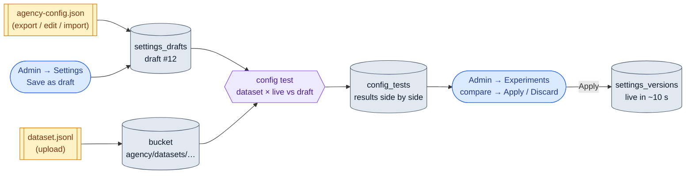
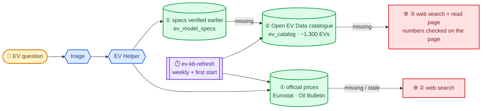

# Data (MySQL & Redis)

## MySQL

Local: MySQL 8.4 in compose (started with HeatWave's defaults: primary key required, UTC, utf8mb4).
Production: OCI HeatWave MySQL. Schema = `migrations/NNNN_*.sql`, applied by the `migrate` job.

| Table | One row per | Written by |
|---|---|---|
| `users` | account (email, role, plan, plan expiry) | edge |
| `refresh_tokens` | issued refresh token (hashed), with its session family | edge |
| `agent_runs` | question answered by a topic (status, tokens, cost, latency, PII-redacted prompt/answer, feedback) | topic services |
| `conversations` | chat history: one row per conversation (id = chat `session_id`, title, pinned, turns) — its messages are that session's `agent_runs` | edge (`/chat`) |
| `llm_calls` | LLM attempt (model, tier, why, tokens, cost, latency, cache/canary) | model gateway |
| `usage_daily` | user × topic × day (runs, calls, tokens, cost) — billing / dashboards | gateway + topics |
| `country_level_info`, `ev_model_specs`, `ev_research_runs` | verified EV facts (cached) and the EV audit log | EV Helper |
| `product_offers` | verified offer seen (price history) | Product Finder |
| `eval_cases`, `eval_runs`, `eval_results`, `drift_reports` | evaluation data | quality worker, feedback |

Rules:

- **All SQL lives in repositories** (`libs/agency_platform/agency_platform/repositories/`, `auth/accounts.py`,
  and each topic's `repository.py`). Routes and agents call repositories — never SQL.
- Migrations are **forward-only and re-runnable** (MySQL DDL isn't transactional). Never edit an applied
  migration; add `NNNN_next.sql`.
- Timestamps are UTC (`DATETIME(6)`), money is `DECIMAL`, ids are UUID strings.

## Chat memory

The full picture with diagrams: **[Chat memory](memory.md)**.

What an assistant remembers of the current chat: the last messages, word for word (EV / Finance / Product Finder
read the last 4). **One memory per chat**, shared by every assistant — switching assistant keeps the context.

| Copy | Where | Kept |
|---|---|---|
| fast | Redis `sess:<user>:<chat>` (last 20 messages) | 24 h after the last message |
| durable | MySQL `agent_runs` of that chat (PII-redacted) | text 30 days (`config/privacy.yaml`) |

When Redis has nothing (expired, restarted), the runner reloads the chat's last answered turns from MySQL and puts
them back into Redis — reopening an old chat continues with context. Deleting a chat erases both.

**Long chats** — the older part of a chat (beyond the last 4 messages) is kept as a short **running summary**
(`conversations.summary`, ≤ 8 bullets): after an answer, in the background, the cheap model (task `summarization`,
low tier) folds the older messages into it once 6 of them are not summarized yet (≈ every 3 questions). Every
assistant gets "summary + last 4 messages + question". The prompt is `prompts/memory.yaml` (editable, versioned).

## Redis

Everything in Redis expires or can be rebuilt — losing it loses no permanent data.

| Key pattern | What |
|---|---|
| `usage:tok:<user>:<day>`, `usage:cost:…`, `usage:topic:…`, `usage:req:<topic>:…` | live daily usage + quota counters |
| `usage:run:<request_id>` | tokens/cost of one run (read when the run finishes) |
| `rl:<key>:<window>` | rate limits (per user, login, register) |
| `acct:<user>` | 60 s account/plan cache |
| `sess:<user>:<chat>` | chat memory: the last 20 messages, **one per chat** (shared by all assistants), 24 h — reloaded from MySQL `agent_runs` when gone |
| `rcache:<topic>:…` | response cache (identical first-turn questions) |
| `llmcache:…`, `route:judge:…` | LLM call cache, routing-judge verdicts |
| `fx:…`, `mkt:…` | exchange rates, market data |

Browse it: [redis.everesto.live](https://redis.everesto.live) (GitHub login, platform-team).

!!! note "Shared Redis"
    In the platform Redis each app gets its own user, limited to keys starting with its `REDIS_KEY_PREFIX`
    (Backstage → Create deployment → Redis). Every key is built with `rkey()` (`agency_platform/cache.py`),
    which puts `REDIS_KEY_PREFIX` in front (empty locally) — e.g. `orchid-agency-backend:usage:tok:…`.
    New Redis code must build its keys with `rkey()` too, or the shared Redis answers `NOPERM`.

## Pictures

The pictures themselves are in **OCI Object Storage** (bucket `dev-agency-media`, private, versioning off,
`oracle_infra` 03_storage). MySQL `images` (migration 0007) only says what each one is and who may see it.

| Kind | Where in the bucket | Who sees it | Deleted |
|---|---|---|---|
| **web** — EV "show me a picture of the Model Y" | `agency/web/<sha256 of the source>` | everyone (public web pictures) | never (shared, stored once) |
| **upload** — a picture the user sent with a question | `agency/uploads/<user>/<chat>/<UTC time>-<8 hex>.jpg` | only that user | with the chat · the account · after 30 days (retention) |

- **Web:** the one found with the cached specs is reused (`ev_model_specs.image_url`, no new search), otherwise one
  image search, remembered for next time. Downloaded once: public address only, ≤ 1.5 MB, no redirects.
- **Uploads:** sent only when the user presses **Send** (paste / drop / 📎 only show a preview in the browser, which
  also shrinks the picture to ≤ 1600 px). Max 4 per message, ≤ 2 MB, JPEG / PNG / WebP — the type is decided from
  the file's bytes. 60 per user per day.
- **What the assistants get:** never the picture. A cheap vision model (task `vision`, `prompts/vision.yaml`) writes
  one line per picture, appended to the question. So every assistant works unchanged, the chat memory stays
  small, and follow-up questions don't pay for the picture again.
- **Serving:** only through `GET /api/v1/images/<id>` (web: public, cached for a year · uploads: owner's Bearer
  token only). The chat shows only `/api/v1/images/<id>` pictures, never third-party links.
- **Settings:** `S3_*` in `.env.example`. Not set → no pictures in answers, uploads refused; everything else works.

## Guardrail events

MySQL `guardrail_events` (migration 0008) + Prometheus `agency_guardrail_events_total{service,kind,action}`: one
row every time a guardrail fires — quota / rate limit / plan, input rejected, injection attempt (question or text in
a picture), PII masked before an LLM call, a number not found on its source page (dropped), unsafe address,
refused upload. **Never the user's text** — only what fired, where, and short technical detail (pattern names,
counts, a domain). Admin → Guardrails reads it; kept `privacy.yaml → retention.guardrail_events_days` (90).

Injection check: `config/guardrails.yaml → injection` — `off` / `flag` (log, still answer) / `block` (refuse; in
a picture only that picture's text is withheld), `threshold`, optional `llm_check` (a cheap model's second
opinion for borderline questions).

## Settings overrides

MySQL `settings_versions` (migration 0009): Admin → Settings saves. The YAML files in `config/` stay the defaults;
a version stores only what differs. Newest version per section is live in every service within ~10 s (Redis
counter `settings:rev`, checked by each service). A value that doesn't validate is refused when saving; if one
ever didn't validate at load, the service keeps serving the file alone. Rollback = a new version with an old
one's content. Sections: plans, guardrails, memory, privacy, evals.

## Experiments: drafts, datasets, config tests

- **Drafts** (`settings_drafts`, 0010): `{section: override}`; from an imported config file or "Save as draft".
  Applying = one `settings_versions` row per changed section. Sections: plans, models, guardrails, memory, privacy,
  evals and `prompts_<topic>` for every `prompts/*.yaml`.
- **Per-request draft:** header `X-Agency-Config-Draft: <id>`, honoured only for admin / service accounts; carried
  to the model gateway as a signed call-token claim. Every config file returns file + draft **for that request
  only**; live traffic never sees it.
- **Datasets** (`eval_datasets`, 0011): JSONL in the bucket, one row per version; checked line by line on upload
  (schema, known assistant, unique ids, ≤ 500 cases, ≤ 2 MB).
- **Config tests** (`config_tests`, 0012): queued by an admin (≤ 50 cases, cost estimate shown), run by the quality
  worker (CronJob `agency-experiments`, every 2 min) as the eval account: each case live and with the draft, both
  checked and judged by the same judge (never the draft's), progress after each case, cancellable.

## EV knowledge base (Germany + France first)

The EV Helper answers from **our own data first** and searches the web only when that can't answer:

| Data | Source | Refresh | Table |
|---|---|---|---|
| Household electricity price, all taxes | **Eurostat** `nrg_pc_204` (2,500–4,999 kWh/year band) | twice a year (job weekly) | `country_level_info` (`official = 1`) |
| Petrol 95 + diesel price, all taxes | **EU Weekly Oil Bulletin** | weekly | `country_level_info` (`official = 1`) |
| EV specs: usable battery, average consumption, AC/DC power, charging curve | **Open EV Data** — MIT + attribution (credited in every answer that uses it) | weekly | `ev_catalog` |

- Countries: `config/agents/ev_research.yaml → kb.countries` (DE, FR). Both official sources cover the whole EU —
  adding a country = adding its code.
- **Range from the catalogue is an estimate** (usable battery ÷ average consumption, not WLTP) and the answer says so;
  the closest model year and the other versions are named.
- A source that fails keeps its last good data; official rows stay valid 220 days (`kb.official_staleness_days`),
  crawled ones 30.
- Not covered yet: car purchase prices, incentives, public charging prices, real consumption of petrol/diesel
  comparison cars (a disclosed 7 L/100 km assumption until then).
