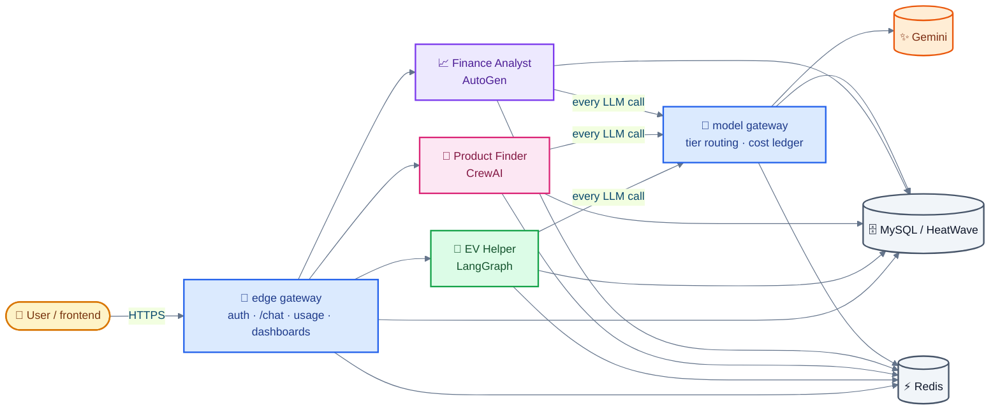

# Autonomous Agency — backend

A platform of **AI assistants ("topics")**, each built with the agent framework that suits it, all
sharing one set of LLMOps guarantees: sign-in, subscription plans, per-topic token + cost tracking,
model routing, evaluation and monitoring.

| Topic | What it answers | Framework | API |
|---|---|---|---|
| **EV Helper** (`ev_research`) | EV specs, charging cost, EV vs petrol/diesel | LangGraph | [agency-ev-research-api](/catalog/default/api/agency-ev-research-api/definition) |
| **Cheapest Product Finder** (`product_finder`) | the cheapest verified offer for a product | CrewAI | [agency-product-finder-api](/catalog/default/api/agency-product-finder-api/definition) |
| **Finance Analyst** (`finance`) | volatility, drawdown, analysis of tickers | AutoGen | [agency-finance-api](/catalog/default/api/agency-finance-api/definition) |

Users talk to **one public API** ([agency-api](/catalog/default/api/agency-api/definition)): they log in,
ask anything at `/chat`, and the question is routed to the right assistant. Every LLM call of every
assistant goes through **one model gateway**, which picks the Gemini model and records tokens and cost.



<small>🟨 user · 🟦 gateways · 🟩🟪🟥 the three assistants · 🟧 model provider · ⬜ data stores</small>

## New here? Read in this order

1. **[Run it locally](getting-started.md)** — the whole stack with one `docker compose up`, first API call.
2. **[Architecture](architecture.md)** — the services, and what happens during one question.
3. **[Using the APIs](apis.md)** — login, streaming answers, errors, dashboards.
4. **[LLMOps](llmops.md)** — how models are chosen, how tokens/cost are counted, how quality is measured.
5. **[Development guide](development.md)** — where code lives, conventions, how to add an endpoint or a topic.

## Repository map

```
libs/agency_platform/     shared platform library: auth, plans/quotas, runner, DB repositories, OpenAPI conventions
services/edge_gateway/    public API: auth, /chat, topics, usage, dashboards, admin
services/model_gateway/   internal OpenAI-compatible LLM router (Gemini tiers, fallback, cost ledger)
services/topic_*/         one service per assistant (ev_research, product_finder, finance)
services/quality_worker/  evals, LLM-as-judge, drift, retention jobs
config/  prompts/         tunable parameters and prompts (YAML, hot-reloaded) — no code change needed
migrations/               MySQL schema (forward-only)
evals/                    evaluation datasets and baselines
openapi/                  exported API specs (what the API pages in Backstage show; CI keeps them in sync)
deploy/  ci/              Kubernetes manifests (moving to agency-backend-gitops) · CI scripts
```

!!! tip "Where things are in Backstage"
    **APIs** — interactive docs of every endpoint (Definition tab of each API) ·
    **CI** — the Pipelines tab of the orchid space ·
    **Code quality** — SonarQube in the Quality tab · **Redis data** — [redis.everesto.live](https://redis.everesto.live) (platform-team).

---

**[Next: Run it locally →](getting-started.md)**
