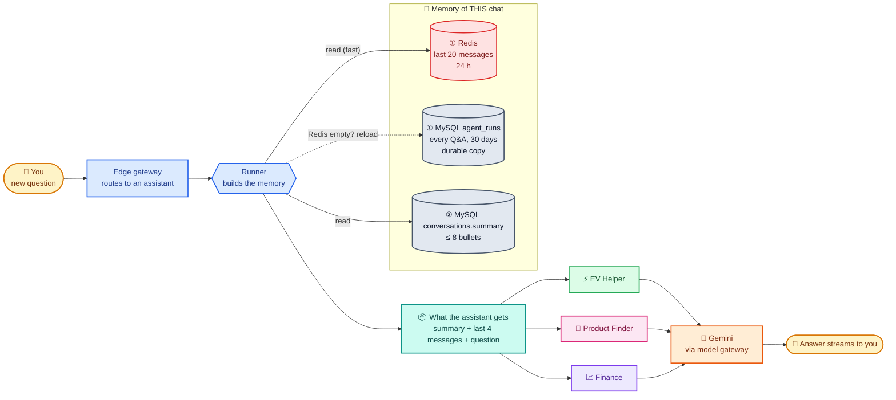
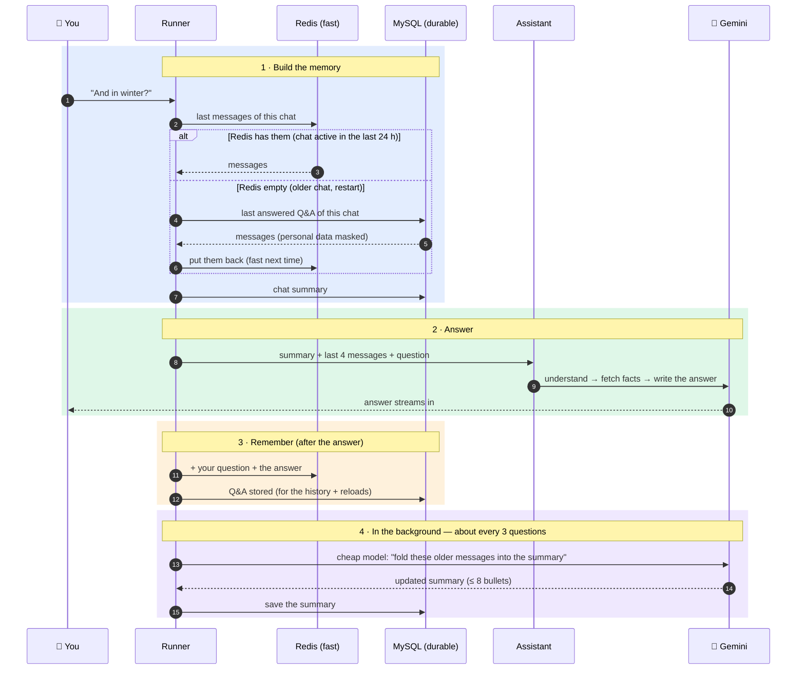
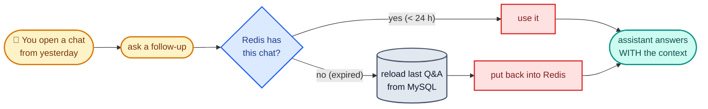
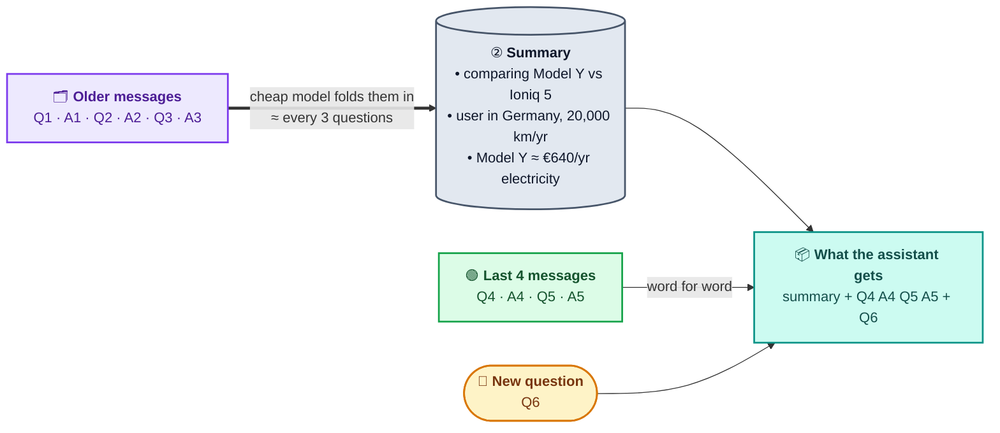
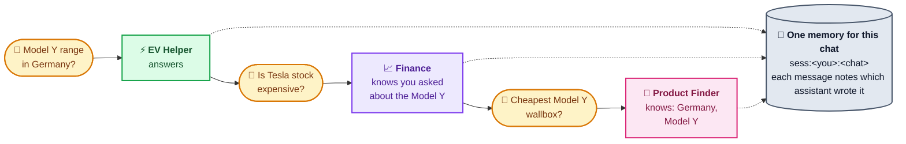

# Chat memory

How the assistants remember a conversation — what they read before answering, where it is stored, and for how long.

!!! tip "In one sentence"
    Before every answer, the assistant gets **a short summary of the older part of the chat + the last 4 messages
    word for word + your new question** — the same memory for every assistant in that chat.

## The layers at a glance

| | Layer | What it holds | Where | Kept | Status |
|---|---|---|---|---|---|
| ① | **Recent messages** | the last messages, word for word (assistants read the last **4**) | Redis `sess:<you>:<chat>` (last 20) · durable copy in MySQL `agent_runs` | Redis 24 h · MySQL text 30 days | ✅ live |
| ② | **Chat summary** | ≤ 8 bullets: your goals, facts you gave, key results, open questions | MySQL `conversations.summary` | as long as the chat | ✅ live |
| ③ | **Project** | project instructions + documents | — | — | 🔜 with projects |
| ④ | **About you** | a few facts you confirmed (country, currency…), for every chat | — | until you delete them | 🔜 planned |

## The big picture

## One question, step by step

!!! note "You never wait for step 4"
    The summary is written **after** your answer has finished streaming. If it fails (gateway busy, …), nothing
    breaks — it is simply tried again with the next questions.

## Reopening an old chat (after 24 hours)

Works for as long as the chat's text exists — **30 days** (`config/privacy.yaml` → `retention.run_text_days`).

## How the summary grows

The assistants read the **last 4 messages** word for word. Everything older is folded into the summary — in
batches of 6 messages, so the cheap model runs about **once every 3 questions**, not every time.

**Why:** a 50-message chat costs about the same per question as a 5-message one, and the assistant still knows
what was said 40 messages ago.

## One memory per chat — shared by all assistants

A **different chat** has its own, separate memory. Memory never crosses users — every key starts with your user id.

## What is stored where, and for how long

| Data | Where | Personal data | Kept | Deleted by |
|---|---|---|---|---|
| Last 20 messages (fast copy) | Redis `orchid-agency-backend:sess:<you>:<chat>` | as you typed them | 24 h after the last message | expiry · *Delete chat* · account deletion |
| Every question + answer | MySQL `agent_runs` | **masked** (emails, phones, IBAN, cards…) | text 30 days, then emptied (tokens/cost stay for billing) | retention job · *Delete chat* · account deletion |
| Chat title, pinned, summary | MySQL `conversations` | title masked; summary from masked text | as long as the chat | *Delete chat* · account deletion |

## Knobs you can turn

| What | Today | Where |
|---|---|---|
| Messages read word for word | 4 | `config/memory.yaml` → `recent` |
| Fold into the summary after | 6 older messages (≈ 3 questions) | `config/memory.yaml` → `fold_at_least` |
| Fast copy size / lifetime | 20 messages / 24 h | `config/memory.yaml` → `max_turns`, `ttl_hours` |
| How the summary is written | ≤ 8 bullets, < 150 words | `prompts/memory.yaml` (versioned, editable) |
| Model for the summary | low tier | `config/models.yaml` → `tasks.summarization` |
| How long text is kept | 30 days | `config/privacy.yaml` → `retention.run_text_days` |

**Admin → Settings → Chat memory** changes the `config/memory.yaml` values live (≈ 10 s), with history and rollback.

## FAQ

??? question "Why does it not remember what I said in another chat?"
    Each chat is separate on purpose (like starting a new conversation). Facts that should follow you everywhere —
    your country, currency — come with layer ④ *About you* (planned), which you will see and control on your
    Account page.

??? question "I deleted a chat — is it really gone?"
    Yes: the Redis memory, the questions and answers, the title and the summary are removed. Only tokens and cost
    stay (anonymous numbers for usage and billing).

??? question "Can the assistant see other users' chats?"
    No. Every memory key and every database query is scoped to your user id.

??? question "Does the assistant remember a picture I sent?"
    Yes — as **text**. When you send a picture, a cheap vision model writes one line about it (e.g. *"white Tesla
    Model Y, German plates"*). That line goes into the question and the memory, so follow-ups know what the picture
    showed without paying for the picture again. The picture itself stays in storage and is shown in your chat
    history; it is deleted with the chat.

??? question "Does memory make answers slower?"
    No. Reading memory is one Redis lookup (plus one MySQL read when it was expired). The summary is written in
    the background after your answer.
